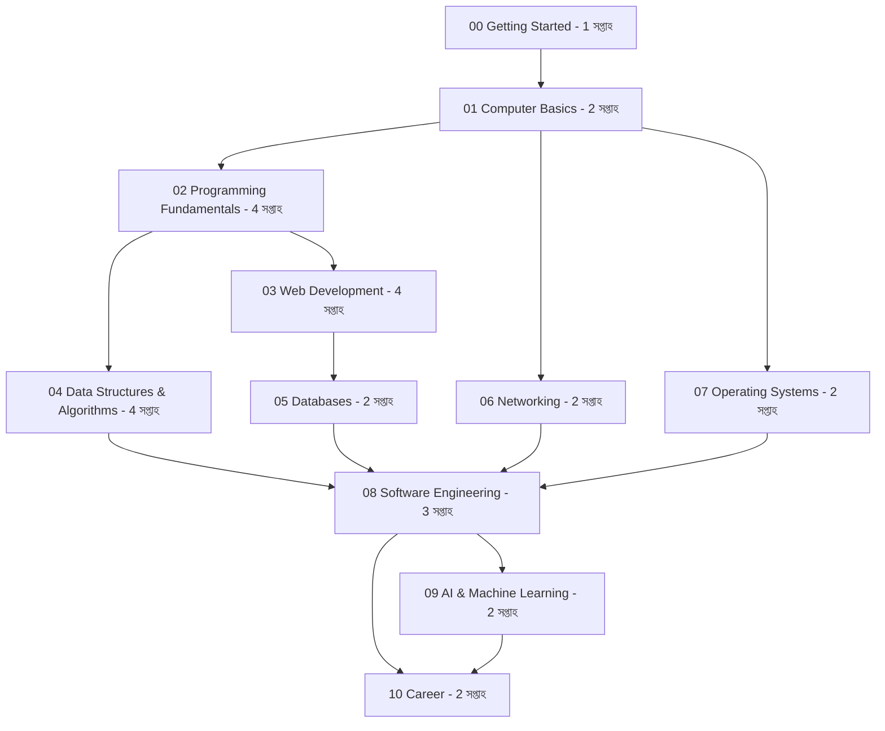

# শেখার Roadmap

এই সময়সূচি সপ্তাহে আনুমানিক ৬–১০ ঘণ্টা অনুশীলন ধরে তৈরি। নতুন শিক্ষার্থী কম সময় দিতে পারলে পথ দীর্ঘায়িত করতে পারবে। প্রতিটি অধ্যায় শেষে একটি ছোট deliverable তৈরি করো।

## অধ্যায়ভিত্তিক পরিকল্পনা
| অধ্যায় | সময় | কাজের প্রমাণ |
|---|---:|---|
| 00 Getting Started | 1 সপ্তাহ | Git repository, algorithm note ও README |
| 01 Computer Basics | 2 সপ্তাহ | CPU/RAM/storage তুলনা এবং CLI practice |
| 02 Programming Fundamentals | 4 সপ্তাহ | validation-সহ CLI calculator বা expense summary |
| 03 Web Development | 4 সপ্তাহ | responsive semantic page ও public API data |
| 04 Data Structures & Algorithms | 4 সপ্তাহ | search/sort complexity note ও DP solution |
| 05 Databases | 2 সপ্তাহ | related tables, JOIN query, transaction demo |
| 06 Networking | 2 সপ্তাহ | DNS/TLS troubleshooting note ও HTTP request |
| 07 Operating Systems | 2 সপ্তাহ | shell workflow, permission ও process note |
| 08 Software Engineering | 3 সপ্তাহ | unit tests, CI workflow ও design decision note |
| 09 AI & Machine Learning | 2 সপ্তাহ | held-out test set-সহ model evaluation report |
| 10 Career | 2 সপ্তাহ | portfolio, project README ও CV draft |

## অধ্যায় শেষ করার মানদণ্ড
- মূল ধারণাটি বই না দেখে নিজের ভাষায় ব্যাখ্যা করতে পারো।
- practice solution-এর যুক্তি বোঝাও এবং অন্তত একটি variation নিজে সমাধান করো।
- Code হলে normal, boundary ও invalid input পরীক্ষা করো।
- Command বা external service ব্যবহার করলে risk, dependency ও limitation নোট করো।

সময় estimate planning aid, পরীক্ষা বা চাকরির নিশ্চয়তা নয়। শেখার গতি অনুযায়ী পরিবর্তন করো।
